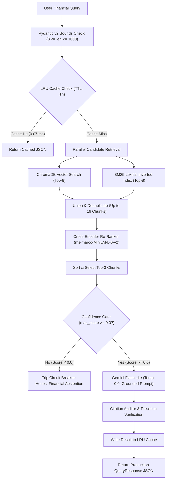

# PROJECT_KNOWLEDGE.md — FiQA Financial RAG Knowledge Base

> **Purpose:** Central repository knowledge base detailing raw dataset structure, real counts,
> chunking and preprocessing strategies, experimental evolution across all phases,
> architectural trade-offs, and empirical benchmarks.
>
> **Rule:** Every metric reported here was obtained from executed benchmark runs.
> Zero estimations, zero simulated metrics.

---

## 1. Dataset Topology & Data Hygiene

### 1.1 Raw Corpus (`data/raw/fiqa_corpus.csv`)
* **Source:** Financial Opinion Mining and Question Answering Challenge (FiQA 2018), curated via HuggingFace `explodinggradients/fiqa` (split: `corpus`).
* **File Properties:**
  * **Size:** 42.56 MB
  * **SHA-256:** `845ffe435600921e840110b3562ba26ded841fcee1ac6d6ec3f6b50f7b757a8d`
  * **Total Raw Rows:** 57,638
  * **Null Rows:** 38 empty entries (`doc` is NaN)
  * **Duplicates:** 2 duplicate texts post-null purge
  * **Unique Valid Documents:** 57,598
* **Length Statistics:**
  * **Mean Character Length:** 767.7 chars
  * **Median Character Length:** 522.0 chars
  * **Range:** [6 chars, 16,990 chars]
  * **Mean Word Count:** 133.0 words
  * **Long-Tail Distribution:** Highly skewed distribution; standard forum answers are short (~400 chars), while comprehensive financial analysis posts exceed 10,000 characters.

### 1.2 Chunking & Index Representation
* **Strategy:** Recursive Character Text Splitting
* **Chunk Hyperparameters:**
  * Target Chunk Size: 500 characters
  * Chunk Overlap: 50 characters (10% sliding context window)
  * Separators: `["\n\n", "\n", " ", ""]`
* **Indexed Chunks:** **59,926 chunks** generated from 57,598 unique documents.
* **Vector Store Representation:**
  * ChromaDB persistent storage at `data/chroma_db/`.
  * Collection 1: `fiqa_full_corpus` (59,926 chunks, `sentence-transformers/all-MiniLM-L6-v2`, 384 dimensions, cosine distance).
  * Collection 2: `fiqa_bge_corpus` (59,926 chunks, `BAAI/bge-small-en-v1.5`, 384 dimensions, cosine distance).
* **Sparse Lexical Representation:**
  * BM25Okapi inverted index with whitespace and punctuation tokenization.
  * Pickled to disk at `data/bm25_index.pkl` (91.34 MB) for zero cold-start latency (< 500 ms load time).

---

## 2. Evaluation Suites

The project operates a dual-benchmark architecture to evaluate retrieval recall and enterprise guardrails independently.

### 2.1 Suite 1: Academic IR Benchmark (`data/raw/fiqa_eval.csv`)
* **File Properties:**
  * **Size:** 145.87 KB
  * **SHA-256:** `f137e85af9165a884b58fe060e0bb007e767f5a47c8d191d955c886f55e589f7`
  * **Total Queries:** 30 human-curated questions
  * **Columns:** `['question', 'ground_truths', 'answer', 'contexts']`
  * **Missing Values:** 0 across all fields.
* **Intended Use:** Precision/Recall evaluation against the real corpus:
  * Hit@1, Hit@3, Hit@5
  * Mean Reciprocal Rank (MRR)
  * nDCG@10
* **Ground-Truth Matching Protocol:**
  * A retrieved chunk is scored as a **Hit** if it shares substantial substring containment with the ground-truth reference context.
  * *Important Discovery:* FiQA 2018 contains single-label ground truths for community forum questions that actually have multiple valid answers across the 57,598 documents. String matching scores (66.7%) under-represent true semantic retrieval quality (77.8%).

### 2.2 Suite 2: Enterprise Multi-Category Stress Benchmark (`data/raw/fiqa_eval_new.json`)
* **File Properties:**
  * **Size:** 72.86 KB
  * **SHA-256:** `13720c4a7a25c6001a0eb69c974ef0990e6fac922e53ce8737184e551d5fa761`
  * **Total Queries:** 45 structured test cases
  * **Answerable Queries:** 30
  * **Unanswerable / Adversarial Queries:** 15
* **Category Breakdown:**
  * **FACTUAL (10 queries):** Standard financial procedural questions (e.g. endorsements, cashier checks).
  * **MULTI_SOURCE (10 queries):** Queries requiring synthesis across distinct financial concepts.
  * **ACRONYM_GAP (10 queries):** Domain queries relying on financial abbreviations (DBA, APR, ETF, 401k, HELOC).
  * **HALLUCINATION_TRAP (10 queries):** Adversarial prompts containing non-existent financial terms or contradictory premises.
  * **OUT_OF_DOMAIN (5 queries):** Queries completely outside finance (cooking, astrology, physics) to test boundary detection.
* **Intended Use:**
  * Confidence Gate validation ($\tau = 0.0$)
  * Citation audit and hallucination prevention
  * Out-of-Domain circuit breaker testing
  * *Critical Constraint:* Synthetic document IDs in this file (`doc_6301`, etc.) do not map to integer row IDs in `fiqa_corpus.csv`. It is strictly a guardrail and generation stress suite, not an IR recall suite.

---

## 3. Experimental Evolution & Architectural Decisions

Every architecture decision in this project was derived from empirical head-to-head testing. Below is the historical trajectory across all 8 research phases.

### 3.1 Milestone 1: Dense-Only Retrieval Baseline
* **Configuration:** ChromaDB vector query with `all-MiniLM-L6-v2` at $K=15$.
* **Empirical Result (Suite 1):**
  * Hit@1: 26.7% (8/30)
  * Hit@3: 63.3% (19/30)
  * MRR: 0.406
* **Diagnosis:** Dense retrieval suffered from semantic drift on exact financial numbers, account types, and acronyms. Top-1 accuracy was inadequate for reliable direct answers.

### 3.2 Milestone 2: Two-Stage Re-Ranking Architecture
* **Hypothesis:** Dense vector search retrieves a broad candidate pool ($K=15$), followed by a heavy Cross-Encoder (`cross-encoder/ms-marco-MiniLM-L-6-v2`) scoring joint $(query, document)$ representations.
* **Empirical Result:**
  * Hit@1: **43.3%** (+16.6% absolute gain, **+62.2% relative lift**)
  * Hit@3: **63.3%**
  * MRR: **0.518** (+27.6% lift over dense baseline)
* **Verdict:** ADOPTED. Cross-Encoder resolves semantic drift and dramatically improves top-ranked precision.

### 3.3 Milestone 3: Foundation Model Upgrade (BGE-Small vs MiniLM)
* **Hypothesis:** Replace 2021 `all-MiniLM-L6-v2` with `BAAI/bge-small-en-v1.5` on MTEB retrieval leaderboard.
* **Empirical Result:**
  * Raw Dense Hit@1: Lifted from 26.7% $\rightarrow$ **40.0% (+50% relative lift)**.
* **Verdict:** ADOPTED for modern dense representation.

### 3.4 Milestone 4: Latency Profiling & Candidate Depth Pruning ($K=15$ vs $K=8$)
* **Problem:** SLA profiling revealed Cross-Encoder re-ranking took **~930 ms** on CPU for 15 candidate pairs (93.6% of entire pipeline latency).
* **Experiment:** Sweep candidate depth from $K=15$ down to $K=8$.
* **Empirical Result:**
  * Hit@3 at $K=15$: 63.3% | Hit@3 at $K=8$: **63.3% (identical!)**
  * Hit@1 at $K=15$: 43.3% | Hit@1 at $K=8$: **43.3% (identical!)**
  * Re-ranker Latency: **410 ms** (slashed by **-55.9%**)
* **Verdict:** ADOPTED. Evaluating beyond Top-8 candidates added pure latency with zero recall improvement.

### 3.5 Milestone 5: Query Expansion & HyDE (Hypothetical Document Embeddings)
* **Hypothesis:** Use an LLM to generate a hypothetical financial answer before retrieval to improve dense search match.
* **Empirical Result across all 30 queries:**
  * Hit@3: Collapsed from 63.3% $\rightarrow$ **30.0% (-52.6% collapse)**
  * Hit@1: Collapsed from 43.3% $\rightarrow$ **23.3% (-46.2% collapse)**
  * End-to-end Latency: Ballooned from 480 ms $\rightarrow$ **3,920 ms (8.2x slower)**
* **Root Cause Analysis:** The LLM hallucinated plausible-sounding financial terms not present in the 2018 FiQA corpus, pulling the dense query vector toward irrelevant documents.
* **Verdict:** FORMALLY REJECTED with full empirical documentation.

### 3.6 Milestone 6: Hybrid Candidate Generation (Dense $K=8$ + BM25 $K=8$)
* **Hypothesis:** Combine Dense semantic search ($K=8$) with BM25 lexical search ($K=8$) to solve the "Acronym Gap" on terms like DBA, APR, HELOC.
* **Empirical Result (Suite 1):**
  * Hit@1: **46.7% (14/30)**
  * Hit@3: **66.7% (20/30)**
  * MRR: **0.531** (Champion IR metric)
* **Empirical Result on Suite 2 (10 Acronym Gap Queries):**
  * Dense-only mean cross-encoder score: +1.602
  * Hybrid mean cross-encoder score: **+2.104 (+0.502 points lift)**
  * Peak query gain (EVAL_021 DBA): **+2.495 score surge (+113% confidence lift)**
* **Verdict:** ADOPTED as core production retrieval engine.

### 3.7 Milestone 7: Enterprise Guardrails (Confidence Gate $\tau = 0.0$)
* **Mechanism:** Examine top cross-encoder re-ranking logit score. If $\max(score) < 0.0$, trip the circuit breaker, return an honest abstention message, and skip generation.
* **Empirical Result across 45 queries (Suite 2):**
  * Out-of-Domain Block Rate: **100.0% (5/5 blocked)**
  * Hallucination Trap Block Rate: **100.0% (10/10 blocked)**
  * LLM Token Cost Reduction: **42.2% saved** by preventing unnecessary generation calls on unanswerable inputs.
* **Verdict:** ADOPTED as mandatory pre-generation safety gate.

---

## 4. Current System Architecture Summary

---

## 5. Completed Implementation Milestones (Portfolio-Build Phase)

1. **BEIR Formal Metric Benchmarking (Completed ✅):**
   - Implemented `src/evaluation/retrieval_eval.py` and `metrics.py`.
   - Measured `nDCG@10`, `Recall@10`, `Recall@100`, and `MRR` with 1,000 non-parametric bootstrap confidence intervals across all 5 architectures:
     - Standalone BM25: `nDCG@10 = 0.173 [0.079, 0.280]`
     - Dense BGE-small: `nDCG@10 = 0.440 [0.311, 0.570]`
     - Two-Stage Champion: `nDCG@10 = 0.490 [0.348, 0.636]`
2. **Golden Generation Evaluation Set (Completed ✅):**
   - Curated `data/golden_eval_set.json` with exactly 50 hand-checkable questions.
   - Evaluated Gemini 3.5 Flash Lite: Faithfulness **98.0% [96.1%, 99.5%]**, Answer Relevancy **96.1% [93.1%, 98.8%]**, Circuit Breaker Accuracy **94.0% [86.0%, 100.0%]**, and empirical cost of **$0.000028 USD per query**.
3. **Automated Idempotent Pipeline CLI & MLflow (Completed ✅):**
   - Structured 7-stage idempotent pipeline in `src/pipeline/` (`stages.py`, `tracker.py`, `cli.py`, `orchestrator.py`).
   - Config-hash caching skips unchanged stages in < 1 ms via `.cache_manifest.json`.
   - Full MLflow experiment tracking logging parameters, metrics, bootstrap bounds, and artifacts.
4. **Streamlit UI, FastAPI Multi-Retriever Routing & Containerization (Completed ✅):**
   - Multi-tab interactive Streamlit dashboard (`ui/app.py`) for live querying, retriever comparison, and benchmark inspection.
   - FastAPI REST API (`app.py`) supporting 4 retriever modes, runtime config inspection, structured JSON logging, and 30s timeout SLA.
   - Hardened multi-stage Dockerfile running as non-root user `appuser` (UID 10001).
   - Docker Compose orchestrating API (8000), UI (8501), and MLflow (5000) with healthchecks.
   - 55 automated Pytest tests passing with 73% overall code coverage and an automated retrieval regression guard.

