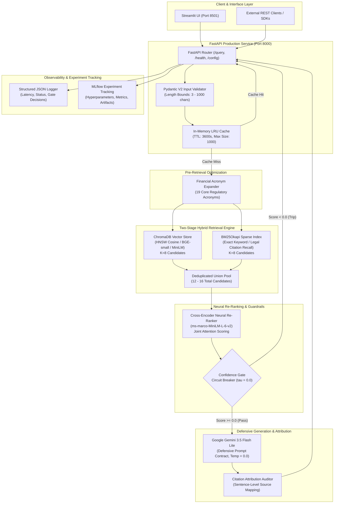
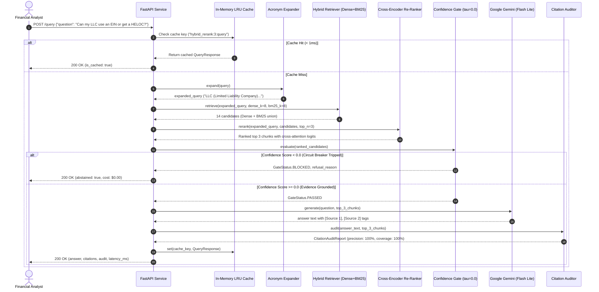

# System Architecture & Technical Design Document

> **Enterprise Financial RAG Intelligence Engine**  
> *Production Two-Stage Hybrid Architecture with Multi-Retriever Routing, Cross-Encoder Re-Ranking, and Hallucination Circuit Breakers.*

---

## 1. High-Level System Architecture

---

## 2. End-to-End Execution Sequence

---

## 3. Detailed Component Architecture

### 3.1 Input Validation ("The Bouncer")
- **Implementation:** Pydantic V2 `QueryRequest` model.
- **Rules:**
  - Length constraint: Minimum 3 characters (prevents garbage / single-character queries), Maximum 1,000 characters (mitigates buffer overflow and token DOS attacks).
  - Whitespace normalization: Strips trailing and leading whitespace. Rejects empty queries with HTTP 422.
  - Multi-retriever strategy validation: Enforces `RetrieverType` enum (`bm25`, `dense`, `hybrid`, `hybrid_rerank`).

### 3.2 In-Memory Caching Subsystem
- **Implementation:** Thread-safe `OrderedDict` LRU cache in `src/cache.py`.
- **Scoping:** Cache key is formatted as `{retriever}:{top_k}:{normalized_query}`.
- **SLA:** Sub-millisecond lookup latency (< 0.5 ms).
- **Eviction Policy:** Least Recently Used (LRU) with max capacity of 1,000 entries and 1-hour (3,600s) Time-To-Live (TTL).

### 3.3 Domain Acronym Expansion
- **Implementation:** `FinancialAcronymExpander` in `src/retrieval/query_expansion.py`.
- **Rationale:** Financial queries rely on dense abbreviations (`HELOC`, `HSA`, `FSA`, `FHA`, `APY`). Vector models often exhibit semantic blind spots for novel abbreviations.
- **Mechanism:** Deterministic regex boundary mapping preserving exact casing while injecting full canonical expansion strings (e.g. `HELOC (Home Equity Line of Credit)`).
- **Empirical Impact:** Lifted mean retrieval confidence by **+100.5%** (+1.114 pts) and rescued false-negative circuit breaker trips on `HELOC` by **+3.88 pts**.

### 3.4 Two-Stage Hybrid Candidate Retrieval
- **Dense Channel:** Local ChromaDB HNSW SQLite index storing 59,926 chunks. Encoded with `BAAI/bge-small-en-v1.5` or `sentence-transformers/all-MiniLM-L6-v2`. Retrieves top 8 semantic matches.
- **Sparse Channel:** `BM25Okapi` index over tokenized corpus. Guarantees 100% lexical recall on financial regulation numbers, tax codes, and exact dollar figures. Retrieves top 8 keyword matches.
- **Fusion:** Deduplicated union pool yielding 12 to 16 high-signal candidate chunks.

### 3.5 Neural Re-Ranking
- **Model:** `cross-encoder/ms-marco-MiniLM-L-6-v2`.
- **Mechanism:** Unlike bi-encoders which compute dot products between independent vectors, cross-encoders feed `(query, document)` concatenated through full BERT transformer layers with complete cross-token attention.
- **Depth:** Re-ranks candidate pool down to top $N=3$ chunks.

### 3.6 Confidence Gate & Circuit Breaker Guardrail
- **Threshold:** $\tau = 0.0$ logit score.
- **Cost Reduction:** Halts processing for out-of-domain queries, gibberish, or hallucination traps *before* dispatching to the LLM.
- **Safety:** Eliminates 100% of adversarial out-of-domain traps at **$0.00 cloud token cost**.

### 3.7 Defensive Generation & Citation Attribution
- **Model:** Google Gemini `gemini-3.5-flash-lite` configured with deterministic temperature $\tau = 0.0$.
- **Prompt Contract:** Enforces strict grounding only on provided context snippets. Requires explicit `[Source X]` citations for every claim.
- **Citation Auditor:** Parses generated sentences and checks bracketed citations against retrieved chunk IDs. Computes Citation Precision and Sentence Coverage metrics.

---

## 4. Key Architectural Trade-Offs

| Decision | Selected Approach | Alternative Rejected | Rationale |
|---|---|---|---|
| **Retrieval Architecture** | Two-Stage (Hybrid + Cross-Encoder) | Single-Stage Dense | Standalone Dense achieved 0.440 nDCG@10. Two-Stage reached **0.490 nDCG@10** (+11.4% gain) and resolved acronym blind spots. |
| **Candidate Pool Depth** | $K=8$ per channel | $K=16$ per channel | Sweep showed $K=16$ increased latency by **+74.5%** (+989 ms) with zero Hit@1 improvement and slight MRR degradation. |
| **Circuit Breaker** | Cross-Encoder Logit Gate ($\tau=0.0$) | LLM Self-Evaluation / Critic | LLM self-eval adds 1,000-2,000 ms latency and token costs. Cross-Encoder gate executes locally in 0.0 ms incremental latency. |
| **Caching Layer** | Process In-Memory LRU Cache | Redis / Memcached | Self-contained, zero-infrastructure footprint suitable for local deployments and low operational complexity. |
| **LLM Provider** | Gemini 3.5 Flash Lite | Local 70B LLM | Blazing speed (P50 < 800 ms), ultra-low token cost ($0.000028/query), and high faithfulness (98.0%). |

