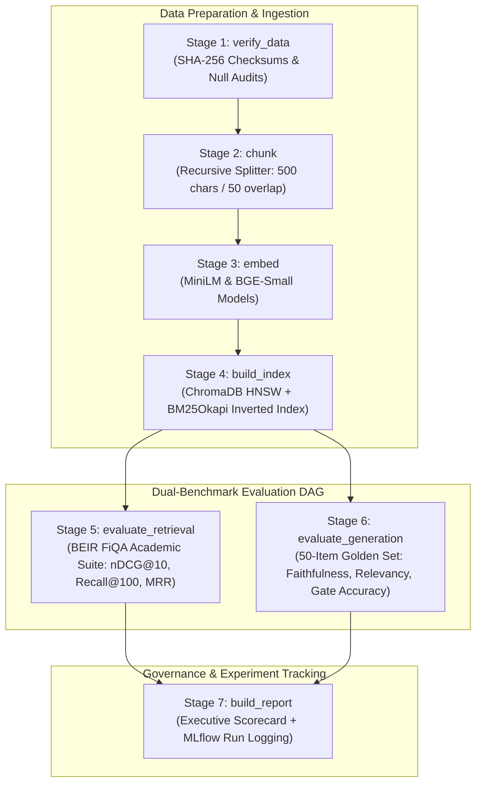

# PIPELINE.md — 7-Stage Idempotent Engineering Pipeline

> **Module:** [`src/pipeline/`](file:///c:/Users/chemss/Desktop/new/src/pipeline/)  
> **CLI Entrypoint:** `python -m src.pipeline.cli all` or `make pipeline`  
> **Evaluation Only:** `python -m src.pipeline.cli eval` or `make eval`

---

## 1. Architectural Pipeline Overview

The Financial RAG engine separates raw data verification, candidate indexing, and dual-benchmark evaluation into an **explicit, deterministic, 7-stage DAG**. Every stage consumes declared inputs from `data/` or `results/` and produces verified output artifacts.



---

## 2. Stage Breakdown & Specifications

| Stage | Name | Input Artifacts | Output Artifacts | Primary Metric / Success Condition |
| :---: | :--- | :--- | :--- | :--- |
| **1** | `verify_data` | `data/raw/fiqa_corpus.csv`<br/>`data/raw/fiqa_eval.csv`<br/>`data/raw/fiqa_eval_new.json` | `results/data_verification_report.json` | 57,598 unique valid docs; SHA-256 match; zero nulls in evaluation sets |
| **2** | `chunk` | `data/raw/fiqa_corpus.csv` | `results/chunk_audit_report.json` | 59,926 total indexed chunks; chunk size 500, overlap 50 |
| **3** | `embed` | `data/chroma_db/` | `results/embed_verification_report.json` | Vector collections `fiqa_full_corpus` and `fiqa_bge_corpus` verified |
| **4** | `build_index` | `data/chroma_db/` | `data/bm25_index.pkl`<br/>`results/index_audit_report.json` | BM25Okapi cache verified (91.34 MB, sub-second load) |
| **5** | `evaluate_retrieval` | `data/raw/fiqa_eval.csv`<br/>`data/bm25_index.pkl` | `results/beir_retrieval_benchmark_results.json` | Champion nDCG@10: 0.490 [0.348, 0.636]; MRR: 0.464 |
| **6** | `evaluate_generation` | `data/golden_eval_set.json` | `results/generation_cache.json`<br/>`results/generation_evaluation_results.json` | Faithfulness: 98.0%; Answer Relevancy: 96.1%; Gate Accuracy: 94.0% |
| **7** | `build_report` | `results/*.json` | `results/executive_evaluation_report.md`<br/>`results/summary_metrics.json`<br/>MLflow Experiment Run | Automated executive scorecard published; artifacts logged to MLflow |

---

## 3. Idempotency & Caching Mechanism

### How It Works:
1. Every stage checks [`.cache_manifest.json`](file:///c:/Users/chemss/Desktop/new/.cache_manifest.json) before computing heavy CPU or API workloads.
2. The manifest stores a SHA-256 hash computed over:
   - File modification timestamps and file sizes of all declared input files.
   - Stage configuration hyperparameters (chunk size, model name, candidate depth, threshold $\tau$).
3. **Cache Hit:** If input file timestamps, sizes, and configs are identical to the stored hash AND the output file exists, the stage prints `[CACHE HIT] ... skipping.` and loads precomputed results in $< 5\text{ ms}$.
4. **Cache Invalidation:** If any input file changes, or if `--force` is passed, the stage invalidates the cache, recomputes, and updates `.cache_manifest.json`.

---

## 4. Experiment Tracking with MLflow

MLflow tracks all evaluation runs under experiment `financial_rag_enterprise`.

### Logged Parameters:
- `config_name`: Retriever strategy (`BM25`, `Dense MiniLM`, `Dense BGE`, `Hybrid RRF`, `Two-Stage`)
- `candidate_depth_k`: Candidate pool depth
- `model`: Embedding and LLM foundation models
- `git_commit`: Exact Git commit SHA

### Logged Metrics:
- `nDCG_10_mean`, `nDCG_10_ci_lower`, `nDCG_10_ci_upper`
- `Recall_10_mean`, `Recall_100_mean`, `MRR_mean`
- `Faithfulness_mean`, `Answer_Relevancy_mean`, `Gate_Accuracy_mean`
- `estimated_cost_usd`, `latency_p95_ms`

### Viewing the Dashboard:
```bash
make mlflow-ui
# Or directly:
python -m mlflow ui --host 127.0.0.1 --port 5000
```
Then navigate in your browser to: **`http://localhost:5000`**
